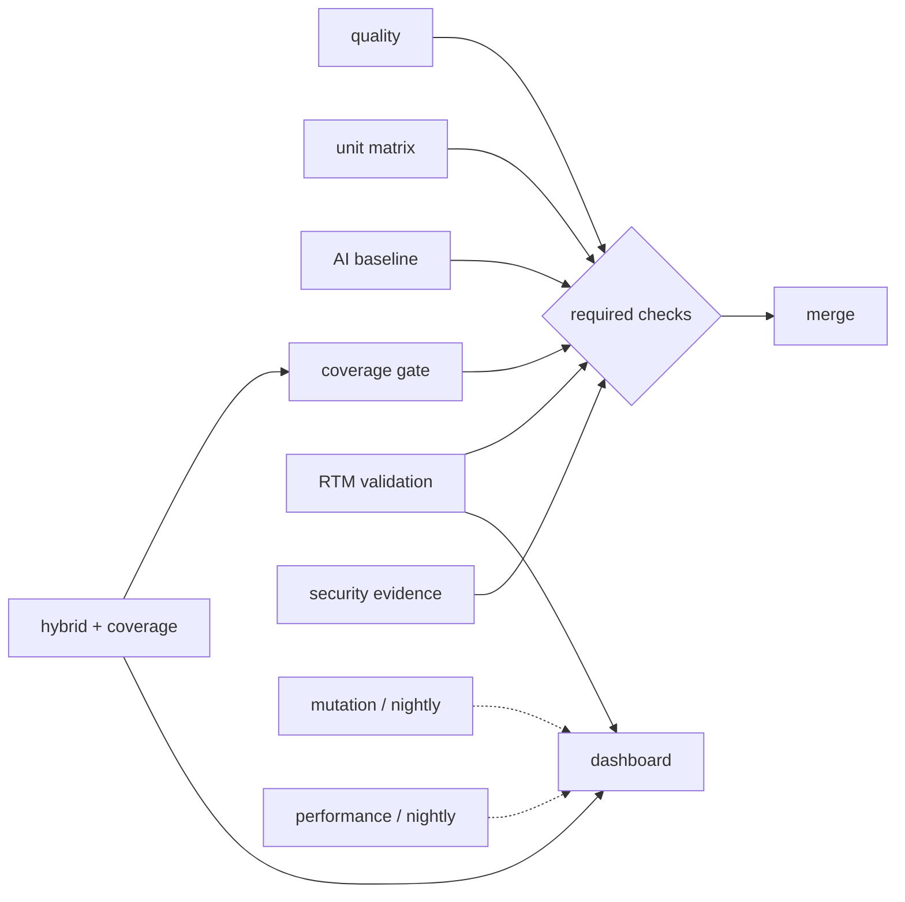

# COMP 441 CI/CD

This document describes the CI/CD pipeline for the tomlkit test suite project.
The executable definition is `.github/workflows/ci.yml`; `tests.yml` has been
retired so there is one source of truth for the project pipeline.

## First-time setup on the fork

The repository is a fork of `python-poetry/tomlkit`. GitHub Actions was enabled
for the fork, but the workflow files had never executed (`gh run list` returned
zero runs before this change). Before the live demonstration:

1. Open **Actions** in `the-dezeray/tomlkit`.
2. If GitHub shows the fork banner, choose **I understand my workflows, go ahead
   and enable them**.
3. Run **COMP 441 CI → Run workflow** once with `run_mutation = none`.
4. Confirm a green run exists and download one artifact as a smoke test.

A workflow-dispatch run is used so the first demonstration does not need a new
commit.

## Trigger map

| Event | What runs | Why |
|---|---|---|
| `pull_request` | quality, unit matrix, AI baseline, hybrid + coverage, RTM, security, dashboard | Fast, reviewable evidence for every change |
| `push` to `master` | same as PR | Protects the integration branch |
| `workflow_dispatch` | all fast jobs; optional full mutation and performance | Live demonstration and on-demand evidence |
| `schedule` (Monday 03:00 UTC) | all fast jobs, full mutation, performance, upstream compatibility | Expensive and external checks run off the critical path |

Concurrency cancels superseded PR runs. Permissions are read-only except for
the release workflow.

## Job graph



`quality`, `unit`, `hybrid`/coverage, and RTM are the intended required checks.
Mutation, performance, security evidence, and upstream compatibility are
nightly or non-blocking so a long external run does not block a small PR.

## Jobs and commands

| Job | Core command | Output |
|---|---|---|
| `quality` | `ruff check`, `ruff format --check`, `mypy tomlkit` | Blocking for `ci/` scripts; project baseline reports are evidence-only |
| `unit` | `pytest -q tests` on Ubuntu/Windows/macOS × Python 3.9/3.12/3.14 | JUnit per matrix cell |
| `ai-baseline` | `pytest -q tests_ai --cov=tomlkit --cov-branch` | AI-only coverage + JUnit |
| `hybrid` | `pytest -q -p ci.priority_plugin tests tests_ai tests_manual tests_integration tests_bdd tests_property tests_tdd --cov=tomlkit --cov-branch` | Coverage XML/JSON/HTML, JUnit, priority report |
| `rtm` | `pytest --collect-only -q` then `python ci/validate_rtm.py` | `rtm_validation.json`, `rtm_validation.md` |
| `mutation` | `mutmut run --max-children 4` with mutmut 3.8.0 | Raw results, summary JSON, survivors |
| `performance` | `python docs/week9/performance_check.py` | Throughput text evidence |
| `security` | `pip-audit`, `bandit` | Security JSON/text evidence |
| `dashboard` | `python ci/build_dashboard.py` | `dashboard.md`, `dashboard.csv`, job summary |

## Downloadable artifacts

Every artifact is attached to the workflow run. Reviewers and the final report
do not need a third-party coverage service.

| Artifact | Download with | Contents |
|---|---|---|
| `hybrid-evidence` | `gh run download <run-id> -n hybrid-evidence` | `coverage.xml`, `coverage.json`, `coverage_gate.json`, `junit.xml`, `htmlcov/`, `priority_order.json` |
| `ai-baseline-evidence` | `gh run download <run-id> -n ai-baseline-evidence` | AI-only coverage and JUnit |
| `quality-evidence` | `gh run download <run-id> -n quality-evidence` | Baseline ruff and mypy reports |
| `rtm-evidence` | `gh run download <run-id> -n rtm-evidence` | RTM validation JSON/Markdown, collected test IDs |
| `mutation-evidence` | `gh run download <run-id> -n mutation-evidence` | Raw mutmut results, summary JSON, survivors |
| `performance-evidence` | `gh run download <run-id> -n performance-evidence` | `performance.txt` |
| `security-evidence` | `gh run download <run-id> -n security-evidence` | `pip-audit.json`, `bandit.txt` |
| `dashboard` | `gh run download <run-id> -n dashboard` | `dashboard.md`, `dashboard.csv` |
| `junit-unit-*` | `gh run download <run-id> -n junit-unit-ubuntu-latest-3.12` | Unit JUnit for one matrix cell |

Open `reports/htmlcov/index.html` locally for the line-by-line coverage view.
The workflow also writes the dashboard to the run's **Summary** page.

## Quality gates

The canonical coverage run is the hybrid suite on Ubuntu and Python 3.12. The
gate is evaluated from `coverage.json`, not from a rounded terminal percentage.

| Metric | Initial gate | Current baseline | Rationale |
|---|---:|---:|---|
| Statement coverage | ≥ 87% | 91.75% (hybrid), 89.4% (`tests/` only) | Blocks a material regression without pretending 100% is achievable |
| Branch coverage | ≥ 82% | 85.01% (hybrid), 84.2% (`tests/` only) | Branch coverage is the weaker signal |
| Combined coverage | reported | 89.88% (hybrid) | Reported in the dashboard for the report |
| RTM references | all existing | 15/16 requirements have a collected test; 14/16 verified manually | A renamed or deleted test must not silently break traceability |
| Tests | zero failures/errors | 1,502 passed + 5 xfailed (hybrid) | Strict xfails remain visible |
| Mutation | evidence, not a hard gate | 77.4% v2 / 81.3% covered (57.8% v1) | Scope-sensitive; guard against regression instead of an arbitrary global number |
| Security | evidence, not a hard gate initially | not previously measured | Findings feed Track B and the final report |

## Current evidence (Week 11 v2)

The authoritative mutation report is
`week11/mutation_v2/mutation_v2_report.md` (PR #4). This CI document does not
duplicate it; it records how the evidence is produced and consumed.

| Metric | Week 7 v1 (AI-only) | Week 11 v2 (final hybrid) |
|---|---:|---:|
| Mutants | 5,389 | 5,389 |
| Mutation score | 57.8% | 77.4% (+19.6 pp) |
| Covered-code score | 62.2% | 81.3% |
| Killed / timeout / survived / no-tests | 3,087 / 26 / 1,890 / 386 | 4,136 / 34 / 956 / 263 |
| Suite | 388 AI-only tests | 1,507 tests (1,502 passed, 5 xfailed) |

The v2 run measures the shipped hybrid suite, not only the group's extra 54
tests, and v1 ran on an earlier commit. The report states this limitation
explicitly. `ci/build_dashboard.py` uses
`week11/mutation_v2/mutation_v2_summary.json` as the committed fallback when a
fresh CI mutation artifact is not present.

If the combined suite shifts the baseline, update the thresholds in
`ci/check_coverage.py` call in `ci.yml` and record the reason in the Week 10/12
metrics log. Do not lower a gate silently to make a red run green.

## Week 7 risk-based test order

`tests_ai` was ranked in Week 7 by complexity-weighted, two-year churn risk. The
result is `week7/priority_order.csv` (149 AI tests, APFD 0.7722 versus 0.6369
for collection order). `ci/priority_plugin.py` reorders the hybrid suite so
those high-risk tests run first; unranked tests keep their normal order. No test
is removed. The first 50 executed node ids, the number of matched tests and the
APFD are written to `reports/priority_order.json` and uploaded in the hybrid
artifact.

To compare with collection order:

```bash
poetry run python -m pytest -q --no-priority-order
```

## Reproducibility

| Tool | Pin | Reason |
|---|---|---|
| Poetry | 2.5.1 | The version that generated `poetry.lock` |
| pytest | 7.4.4 (Poetry lock) | Keeps Python 3.9 compatibility |
| pytest-bdd | 9.0.0 (Python ≥3.10) | Parses Gherkin docstrings; Python 3.9 unit job skips BDD |
| hypothesis | 6.129.5 (Poetry lock) | Track D property tests |
| mutmut | 3.8.0 in `ci/mutation-requirements.txt` | Matches the Week 11 mutation run; requires Python ≥3.10 |
| Python | 3.9–3.14 matrix; 3.12 canonical | Matches `requires-python` and the Week 10/11 environment |
| Coverage | branch mode in `.coveragerc` and `--cov-branch` | Statement and branch evidence |

The default dev group keeps `mutmut < 3` so the Python 3.9 unit job can install
the project. The mutation job creates `.mutation-venv` and installs the pinned
Week 11 tool environment separately. The mutation scope and the one deselected
recursion test are documented in `week11/mutation_v2/README.md`.

Local reproduction:

```bash
git submodule update --init --recursive
poetry install
poetry run python -m pytest -q -p ci.priority_plugin
poetry run python ci/check_coverage.py --coverage reports/coverage.json
```

## Security evidence

The `security` job is deliberately evidence-first: `pip-audit` and `bandit`
write reports and the job does not yet block merges. This avoids turning an
unrelated advisory in a development dependency into a red build during the
project. For the final submission, summarise the findings under Track B and
raise the job to blocking once high/critical findings are triaged.

## Branch protection / ruleset

Create a ruleset on `master` with these required checks:

- `Quality / lint and types`
- `Unit / ubuntu-latest / 3.12`
- `Hybrid suite / coverage`
- `RTM validation`

Also enable **Require branches to be up to date before merging** and
**Do not allow bypassing the above settings**. PRs from other forks may need
maintainer approval before their workflows run; use a branch in the main fork
for the live demonstration.

## Mapping to the COMP 441 brief

| Brief milestone | Deliverable | CI evidence / job |
|---|---|---|
| Week 5 | Charter, test plan, risks, estimation, toolchain proof-of-setup | This document, `ci.yml`, pinned tool table, first green dispatch run |
| Week 6 | AI baseline report, coverage before manual tests, RTM ≥10 requirements | `ai-baseline` job (AI-only coverage + JUnit), `rtm` job (all 16 requirements checked) |
| Week 7 | Mutation score of AI-only suite, survivors, AI/risk-based priority order | `week7/` evidence, `mutation` nightly artifact, `priority_plugin` + `priority_order.json`, dashboard APFD |
| Week 8 | Specialised checkpoint, TDD log, first BDD scenario | `hybrid` runs `tests_tdd/` and `tests_bdd/`; JUnit/doc evidence |
| Week 9 | Exploratory report, hybrid suite v1, integration/acceptance suites, light performance/usability | `hybrid` runs `tests_integration/` + `tests_bdd/`; `performance` job and artifact |
| Week 10 | Track C checkpoint, quality metrics dashboard (defect density, coverage, mutation trend) | `dashboard` artifact: coverage, test counts, defect density, mutation, Week 10 baseline comparison |
| Week 11 | Mutation report v2, Track E checkpoint, completed TDD log | `week11/mutation_v2/mutation_v2_report.md` (77.4% v2), `tests_tdd/`, `tests_property/`, `mutation` job/artifact |
| Week 12 | Final report, hybrid suite, RTM, CI/CD configuration, declaration form; Track B security | `ci.yml`, `dashboard`, `rtm-evidence`, `security-evidence`, `release` build/verify |
| Week 12 live demo | CI/CD pipeline demonstration and Q&A | `docs/ci-cd-demo.md` |

## Retired workflow

`.github/workflows/tests.yml` was the upstream unit-only workflow. It is
replaced by the `unit` and `hybrid` jobs in `ci.yml`. The upstream
poetry/poetry-core compatibility check remains in `integration.yml` and now
runs nightly or on demand; it is not the project's integration suite.
